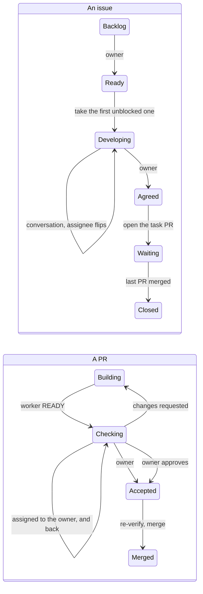

# Orchestrator workflow

The orchestrator owns `dev`. It develops issues with the owner until they are agreed, turns approved
issues into task PRs, reviews them, and merges them. It doesn't write feature code. Every mechanical step is a script in `scripts/orchestrator/`; all of
them retry transient GitHub errors and fall back to SSH when HTTPS pushes fail.

| Step                                                                                                                                                                                                                                                                                               | Script                                                                                                             |
| -------------------------------------------------------------------------------------------------------------------------------------------------------------------------------------------------------------------------------------------------------------------------------------------------- | ------------------------------------------------------------------------------------------------------------------ |
| Open a task PR: a placeholder branch named `<pr>-<words>` (workers use `.worktrees/auto-<branch>`) plus a draft PR whose body points at the task workflow, `Closes #<issue>` and the task file. `--spec` replaces the issue's body; `--part` is for a PR that is not the issue's last. Idempotent. | `open-task.sh <issue> <task.md> [--spec spec.md] [--part] [--slug s]`, `open-task.sh --direct "<title>" <task.md>` |
| Lift a hold and post `[orchestrator] GO`.                                                                                                                                                                                                                                                          | `release-hold.sh <pr> [note.md]`                                                                                   |
| Watch task PRs (READY, QUESTION, pick-ups, stale reviews, merges), the board and what is assigned to you.                                                                                                                                                                                          | `watch-prs.sh` (`ONESHOT=1` to return after the first event)                                                       |
| Test-merge one or more PRs onto `dev`, then run every check; `--packages "<ws> <ws>…"` limits only tests, and `--bench` runs the sector benchmark.                                                                                                                                                 | `verify.sh [--bench] [--packages "<ws> <ws>…"] <pr>…`                                                              |
| Squash-merge, close the task's issue, delete the branch, fast-forward the main checkout. Idempotent.                                                                                                                                                                                               | `merge-task.sh <pr> [--subject s] [--body-file f]`                                                                 |
| Read the board, move a card, say whose move it is, read or set what blocks an issue, or open an issue (new work, a follow-up, an idea) and add it to Backlog.                                                                                                                                      | `board.sh list\|move\|next\|mine\|turn\|blocked\|block\|unblock\|issue\|remove`                                    |
| Post a review outcome or a reply on a PR or an issue, move its card and set whose move it is.                                                                                                                                                                                                      | `review.sh <pr or issue> changes\|owner\|approve\|answer\|ask <comment.md>`                                        |

Worker branches are updated by fast-forward-only pushes; if a remote branch moved, workers fetch and merge it, never force-push. `verify.sh` removes `lib/*/dist` and `apps/*/dist` after assembling the review merge so checks begin without stale build output, as in CI.

CI and stress jobs use the `CI_RUNNER` repository variable; publishing uses `CI_RELEASE_RUNNER`. Set either to `self-hosted` to select the organisation's runners. Delete the variable to fall back to `ubuntu-latest` (the workflow default).

## The board

The owner tracks all work on the shared GitHub project
[vworlds](https://github.com/orgs/vworlds/projects/4). A card is an issue or a PR. Act on
`vworlds/vecs` cards, and on another repository's cards only when they are assigned to you. Answer
on that card. `board.sh mine` lists those too, and the watcher reports them as `ASSIGNED repo#n`.

**An issue is where an idea is developed and agreed. A PR is where one delivery of it is built and
checked.** The columns mean different things for each:

| Column      | An issue                                                                                        | A PR                                                                           |
| ----------- | ----------------------------------------------------------------------------------------------- | ------------------------------------------------------------------------------ |
| Backlog     | An idea or a ticket, possibly one vague line. Nobody works on it.                               | —                                                                              |
| Ready       | The owner wants it developed, in priority order. One that another open issue blocks waits here. | —                                                                              |
| In review   | Being developed in conversation on the issue, until the owner agrees with what it says.         | A delivery being checked: by you, or by the owner when it is assigned to them. |
| Approved    | The owner agrees with what the issue says. Open its task PR.                                    | The owner agrees with the delivery. Re-verify and merge.                       |
| In progress | Its PRs are open. It waits here until they close.                                               | A worker is building it.                                                       |
| Done        | Closed by the merge of its last PR, or closed as not planned.                                   | Merged or closed.                                                              |

_Figure 1: the two lifecycles. Developing and Checking are the In review column, Agreed and Accepted
are Approved, Waiting and Building are In progress, Closed and Merged are Done. The owner makes the
moves marked "owner"; scripts make the rest._

### The assignee is whoever must act

This holds for issues and PRs, on the board or not.

- **Assigned to the owner:** they must read, playtest, answer or decide. Hand over a delivery or
  a developed issue with `review.sh <ref> owner`, and a question with `review.sh <ref> ask`. The
  comment must say what to look at, how to run it, and which decisions are theirs.
- **Assigned to you** (the login the scripts run as): act on it, even if all it needs is a reply.
  `board.sh mine` lists these. When you are done, take yourself off (`review.sh <ref> answer`,
  `board.sh turn <ref> nobody`) or hand it to the owner if you need them.
- **Nobody assigned:** a worker has it, or nothing is pending.
- After a review the owner takes themselves off or assigns you. Read their comment on the card,
  then act.

### Issues: develop, agree, then open the PR

- **Take the first card of Ready that nothing blocks** (`board.sh next`); don't wait to be told.
  Move it to In review and assign yourself while you work on it. A blocked card is not touched,
  whatever its place: it stays in Ready until its blockers close.
- **Develop it on the issue.** An issue may start as one vague line. Read the code, then write on
  the issue: questions, options with a recommendation, and finally the spec (what, why, the
  decisions, done-when, how it will be checked and whether the owner will be asked to playtest).
  Assign the owner each time you need them. A ticket that is already precise takes one round.
- **Gating:** bugs with a reproducer or a profile (a crash, wrong result, divergence, or measured
  hot-path cost) go straight to work (`open-task.sh --unapproved` when they have an issue).
  Everything else waits for Approved; an owner's "go" in chat is the approval for a direct PR.
- **Shortcut: a direct PR.** When something has been settled with the owner in chat and they say
  to go, open the task PR without an issue: `open-task.sh --direct "<title>" <task.md>`. Their
  word in chat is the approval. The task file must carry everything that was agreed, because no
  issue holds it. If it is not clear that they said go, ask in one line.
- **On Approved:** replace the issue's body with the agreed text (`open-task.sh --spec`; GitHub
  keeps the earlier versions in the edit history) and open the draft PR with the final prompt. The
  issue goes to In progress and stays on the board until its PRs close. One issue can have several
  PRs: the last says `Closes #n`, the others `Part of #n` (`--part`).
- **Dependencies are issue relations.** An issue that needs another one first is marked "blocked
  by" it: `board.sh block <issue> <blocker…>`, and `board.sh blocked <issue>` lists the open
  blockers. Set them when you open an issue, so the owner can see what can be launched.
- **New work, a follow-up, an idea:** `board.sh issue` opens an issue in Backlog for the owner to
  decide, with its relations. Issues that came from the first engineering plan carry the label
  `planned` and an epic label (`E5` to `E11`) and keep their plan names (`E6-T2 — …`); new issues
  don't get such names.

### PRs: build, check, merge

- **The PR holds the delivery's conversation:** the worker's rounds, your review, the evidence,
  the playtest steps and the owner's playtest feedback. When a playtest changes what was agreed,
  also correct the issue's body, so the issue stays true.
- **Every PR goes to the owner before it merges.** Assign it to the owner for review; no class of
  PR is merged without owner review.
- **Releases are cards of their own.** Record the PRs they carry, whether the wire changes, the
  stress and benchmark comparison, and whether consumers must deploy server and client together.
- **On Approved:** re-verify if `dev` moved, stop the worker, merge. The merge closes the issue
  and moves both cards to Done.

### Everything else

- **Write on the card, not in the chat.** Results, conclusions, questions and next steps about one
  item go in a comment on its issue or PR; then move the card and set whose move it is. The chat
  with the owner is for coordination: priorities and order across issues, how the project is
  run, and problems that span several items. Don't report the status of single items there; the
  column and the assignee say it.
- **Every state change is a card move.** The scripts make the moves that belong to their step. Use
  `board.sh move` and `board.sh turn` for anything else, so no card sits in a stale column.
- **Watch the board while work is going on.** `watch-prs.sh` wakes you only for what needs you:
  a worker's READY, QUESTION, DESIGN or BLOCKED; a person's comment on any issue or PR; a card the owner moved to Approved or In review (`BOARD`); the first unblocked card of Ready changing (`NEXT`); an approved issue that nothing blocks, at once or when its last blocker closes (`LAUNCH`); something newly assigned to you (`ASSIGNED`); the owner taking themselves
  off a card (`OWNER DONE`); a stale review. Everything else (other worker notes, cards moving to
  In progress or Done, your own moves and merges) stays quiet and is listed with the next real
  event. It polls GitHub from the shell every 10 seconds, so it costs nothing while nothing
  happens. Run it with `ONESHOT=1` and start it again after each event. If it ends on its own
  (`MAX_MINUTES`, or the runner's limit) because nothing happened for two hours, don't start it
  again: the owner is away and will say when work resumes.
- **Keep the watcher smart.** When it wakes you for something that needed no action, or for
  something it could have done itself, change the script so it doesn't happen again.
- `VECS_BOARD=off` turns the board steps off, for forks and offline work.

## Review and merge

1. Read the READY report and the diff. Verify the behavior independently: run the code, and use
   your own oracle for any invariant the worker claims. Check per-tick cost against
   `lib/vecs/docs/design-guide.md`; require benchmark evidence for hot-path changes.
   Workers report CI with `scripts/agent/wait-checks.sh <pr>`'s exit code and last line:
   green (0), red with a failure digest (1), or no verdict (2). No verdict means
   `[worker] BLOCKED: checks gave no verdict`, not a code failure.
2. `verify.sh <pr>` (with every other PR that will land alongside it).
3. Post the outcome with `review.sh`: `[orchestrator] CHANGES REQUESTED (round N)` (`changes`),
   `[orchestrator] OWNER REVIEW` for gameplay the owner must playtest or anything else they must
   decide (`owner`: the card stays In review, assigned to the owner), or `[orchestrator] APPROVED` (`approve`).
4. **Stop the worker before merging**, so it doesn't spend tokens reacting to the merge. Workers
   are opencode jobs; stop the job before merging.
5. `merge-task.sh <pr>`.
