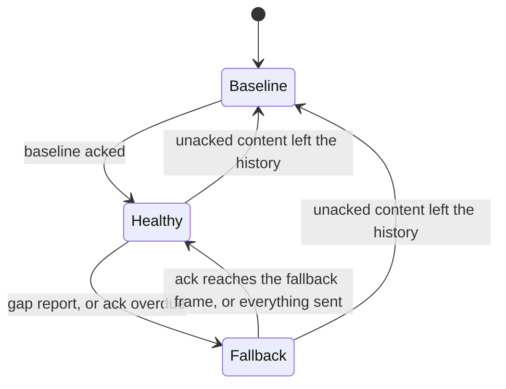

# Replication

How `ServerWorld` keeps a client's replicated state equal to its own over an unreliable, unordered
datagram channel, and what it costs. This is the architecture; the guides for the people who use it
are [Sessions](../lib/vecs-server/docs/sessions.md) (server),
[Client world](../lib/vecs-client/docs/client-world.md) (client) and
[Frames](../lib/vecs-protocol/docs/frames.md) (wire).

## The invariant

The server numbers every frame. A **diff** `(from, to]` says what changed after frame `from`, up to
and including frame `to`, with each component appearing once at its latest value. The client's
**version** is the newest `to` it has accepted, and it acks that number.

> A client at version `T` holds exactly the server's state at `T`.

It holds by induction, and one rule maintains it: the client accepts a diff only if `from <= version`.
The state at `version` is exact and the diff carries everything that changed after `from`, at its
value as of `to`. What changed in `(from, version]` is rewritten with that newer value, and nothing
is missing. A diff with `from > version` lacks what changed in `(version, from]`, so accepting it
would break the invariant for good. An ordinary diff like that is a protocol error: the client closes with
`CLOSE_PROTOCOL_ERROR_CODE` (#213).

The server cannot know the client's version, only its newest ack, which is at or behind it. A delta
from the ack is therefore always safe. That is the default, and everything below builds on it.

## Plain deltas, and what they cost

Each frame a session gets `history.pull(ack, frame)`: every change in `(ack, frame]`, merged out of
the session's history window (#216). A baseline (`fromFrame` 0, the whole view) replaces a delta when
the client cannot be caught up with one, and while a baseline is in flight the server sends no state.
A frame whose diff is empty is not sent unless it carries RPC traffic, or a keepalive is due
([below](#the-keepalive)).

The price is redundancy. The ack lags the frame by a round trip, `L` frames, and a change that is not
superseded by a later one stays in every frame's delta until its ack arrives: it is sent `L + 1`
times. At 30 Hz and a 200 ms round trip that is 7 times. Changes that are superseded cost nothing
extra, because the merge keeps one value per component, so the waste is in changes that happen once
and then sit still, such as the baseline of a dead-reckoned body.

## The optimistic base

`ServerWorldOptions.redundancyFrames` (`R`, an integer of at least 1 and less than `historyFrames`)
opts in to sending each frame as a delta from a **base** later than the ack:

```text
base  = max(ack, the state frame of the send R sends ago)
diff  = history.pull(base, frame)
```

A **send** is a frame in which the session was sent a baseline or a delta with content, or, with
`keepAliveFrames`, a [keepalive](#the-keepalive). Frames that sent nothing because their diff was
empty, or were withheld while a baseline was in flight, are not sends. The **state frame** of a send
is the newest frame at which the session's replicated state had changed as of that send: the
`toFrame` of the newest per-frame diff with content that the server recorded into the session's
history (`History.lastContentFrame`). A send that carries a new change names its own frame. A send
that only carries a change again, or carries nothing, names the earlier frame where the state last
changed. The frame carries the **optimistic marker** (a field on `Server2Client`) exactly when
`base > ack`. Unset, the base is the ack, nothing is marked and the wire is byte for byte what it
always was.

- **The state is the same from a send's state frame to the send.** Nothing changed in between, so
  the client that holds the send holds the state frame, and a delta from the state frame holds
  exactly what one from the send would: `(stateFrame, frame]` and `(sendFrame, frame]` merge the same
  changes, with no extra bytes. The base is therefore a frame the client holds whenever it received
  that send or any later one, and the claim never depends on a frame that carried nothing.
- **The redundancy is counted in sends.** The client holds the base, or a newer frame, unless it lost
  all of the last `R` sends. Up to `R - 1` lost frames in a row cost nothing, however far apart in
  time the sends were: `R = 1` sends every change once, `R = 2` survives any single lost frame, `R = 3`
  any two in a row. In a view that changes on every frame each frame is a send with its own state
  frame, and the base is `frame - R`.
- **A lost send that carried nothing the client lacked costs nothing at all.** A keepalive, or the
  repeat of a change the client already holds, names the state frame of the change before it, which
  the client holds, so losing it never moves a base past what the client holds. Take `R = 2` and sends
  at 100 (a change), 101 (its repeat) and 102 (a keepalive): the delta of 103 starts at 100, the state
  frame of the send two back, and a client that lost 101 and 102 is at 100 and applies it. Naming the
  frame of the send, 101, would read as a gap, though 100 carried everything.
- **Every change is carried by `R` consecutive sends, however sparse the traffic.** A change made in
  frame `c` is a send, and so is each of the next `R - 1` frames, because their bases are still the
  state frames of older changes, before `c`, and their diffs contain it. The send after those starts
  at `c`, and no longer carries it. Changes that follow each other closely share the sends in
  between.
- **`ack` floors the base**, so a diff never starts before the ack and the pull never merges more
  frames than a plain delta would: `R` of them in a busy view, where a plain delta merges `L + 1`.
  Frames since the base that sent nothing hold nothing, so merging them costs a few empty slots and
  adds nothing to the diff. A view that has not changed since the ack has nothing to presume: every
  ring entry is at or before the ack, the base is the ack, and its keepalives are plain deltas.
- **A baseline needs no special case.** It is a send, and the ack floor does the rest. The baseline
  being in flight makes the session unhealthy, so no state is sent, and once it is acked the ack is
  the baseline's frame. The base starts there and moves up as sends follow the baseline, so the delta
  that ends the wait carries everything withheld while the baseline was in flight. The first `R`
  sends after a baseline are therefore from the baseline, and not optimistic.

Two designs came before this one. Choosing the base by frame number, `max(ack, min(frame - R, newest
send))`, patched two symptoms of a frame number, the first change after a quiet stretch and the delta
that ends a baseline wait, but not the cause: between the two bounds the base is still often a frame
that was not sent. On the simulated link below (seed 1, 60 s, one entity changing every fourth frame)
it made `R = 2` send 54% of the unset run's bytes with 89 gap reports, against 44% and 8 with the
base on state frames. Choosing the base by the frame of the send, the design this replaces, fixed
that but named a frame that can carry nothing the client lacked. With the keepalive that is every
frame of an idle view: a lost keepalive, or `R` of them in a row, became the base of the next frame,
and a client still at the previous change read it as a gap. An idle view over the same link reported
279 gap reports a minute at `R = 1` and 28 at `R = 2` for nothing it was missing.

The marker is what makes the presumption safe to state. A marked diff says: _I assumed you hold
`base`; if you do not, this is not a protocol error._

### When the server is optimistic

Only while the session is **healthy**. Otherwise the base is the ack.

| Condition for healthy                                      | Why                                                     |
| ---------------------------------------------------------- | ------------------------------------------------------- |
| The session has acked a baseline                           | Before that the client holds nothing to presume on.     |
| No baseline is in flight or needed                         | The client is about to reset; #216 owns that handshake. |
| No fallback is running                                     | See below.                                              |
| The ack is not overdue: the liveness timer has not expired | See below.                                              |



## When the presumption is wrong

The client does not receive a frame the base presumed, because `R` frames in a row were lost, or a
frame was reordered behind the one built on it. Three mechanisms cover it.

**The client holds the diff.** A marked diff with `from > version` is put in a bounded set of held
diffs (`MAX_HELD_DIFFS`, 8: about a round trip of frames at 30 Hz, and a full set drops its oldest,
which is harmless because the fallback supersedes whatever is held). As soon as `version >= from` it
is applied, and a held diff is dropped once `version >= to`. A late or reordered frame therefore
heals the gap with no round trip. An unmarked diff with `from > version` is still a protocol error.

**The client reports the gap.** Holding a diff sets a flag. The next `send()` carries
`Client2Server.gap` if a diff is still held at that moment and clears the flag; a gap that closed
before the ack went out is not reported. Each further held diff raises the flag again, so a report
the link lost is repeated by the next frame.

**The server falls back.** A gap report makes the session's base the ack, from the next frame
(`fallbackFrame`), until the ack reaches `min(fallbackFrame, newest)`, where `newest` is the state
frame of the newest send, the last change that was ever sent: the client has caught up with the frame
the fallback began at, or already holds everything that was ever sent. The second condition keeps a
fallback begun in a quiet moment, when its first frame is empty and the ack can never reach it, from
lasting until the next change has been sent and acked. Because it is a state frame, a keepalive or
the repeat of an older change does not move it: a quiet view's fallback ends when the client has the
last change, not when it has acked the latest keepalive. A report that arrives while a fallback
runs is ignored, so reports repeated once per ack do not extend it. A report that arrives during a
baseline handshake starts a fallback that the baseline's ack ends at once.

## Liveness: the ack timeout

A loss that nothing follows is invisible to the client: a change is lost in all `R` frames that carry
it, it ages out of their window, nothing else changes, and no later frame shows a gap. A gap report that
the link lost, or a client stuck behind a hole, ends the same way. So the server also watches the
ack.

The session keeps a **probe**, the state frame of the oldest content send that is still unacked, and
when it was sent. It is a state frame like the ring's entries, so the repeat of a change the client
has already acked never arms it: an ack that reaches the change satisfies it, and the loss of a
repeat is nothing to chase. Once the ack has not reached the probe for longer than the **ack
timeout** the session falls back exactly as for a gap report. The probe is rearmed by the next
content frame sent after the ack passes it. The timeout is the one baselines in flight already use: twice the session's smoothed ack
round trip, at least 100 ms, and 1 s before the first sample (`RttEstimator`, RFC 6298 style, no new
constants). A single content frame in flight is therefore found within the timeout plus a frame, and
the fallback delta arrives one link delay later.

State per session is a ring of the state frames of the last `R` sends (`SentFrames`, `R` numbers
allocated with the session and written once per send) and three more values: `probeFrame`,
`probeSentAtMs` and `fallbackFrame`. The state frame is read from one integer the history keeps for
every session, `lastContentFrame`, written once per frame recorded, which is also what lets a pull
that starts at or after it answer an empty delta without merging a slot. Reading the base is one load,
and nothing is allocated per frame. A world that does not set `redundancyFrames` allocates no ring and
keeps none of the rest.

## Cost and trade-off

A change costs `R` times its size instead of `L + 1`, whatever the lag. The price is paid when
`R` sends in a row are lost: the client's view stops until the fallback delta reaches it, about one
round trip after the gap was detected, and about the ack timeout plus a link delay when the report or
the tail was lost. The client's interpolation buffer, three frames by default, hides part of it.
Running this on the simulation harness (`lib/vecs-server/tests/lossy_replication.test.ts`: a 200 ms
round trip, 5% loss each way, reordering, 60 s, 40 entities, seed 1) gives, as a share of the bytes
sent with `R` unset:

| `R` | Every component changes every frame | Three entities change per frame | One entity changes every fourth frame |
| --- | ----------------------------------- | ------------------------------- | ------------------------------------- |
| 1   | 78%                                 | 53%                             | 31%                                   |
| 2   | 81%                                 | 39%                             | 44%                                   |
| 3   | 90%                                 | 51%                             | 62%                                   |

and, for the stalls of the client's view:

| `R` | Stalls, three entities per frame | Late changes, one entity every fourth frame |
| --- | -------------------------------- | ------------------------------------------- |
| 1   | 45 (mean 267 ms, max 333 ms)     | 32 of 435 (slowest 567 ms)                  |
| 2   | 4 (mean 308 ms, max 333 ms)      | 4 of 435 (slowest 467 ms)                   |
| 3   | none                             | none                                        |

A stall is the client's accepted version standing still for more than one frame interval longer than
the longest it ever stood still with `R` unset on the same seed (100 ms here). That measures a view
that changes on every frame. In the sparse workload the view also stands still for the quiet between
changes, so the harness counts the changes that were late instead: those that reached the client more
than one frame interval later than the slowest change with `R` unset (167 ms here), counting from the
frame the server made them in. In the first workload a resent change is superseded by the next
frame's, so plain deltas are no larger than one frame's and only the cost of `R` copies and of
fallbacks shows. The second and third are the case this design is for: a change that happens once is
not superseded, and plain deltas resend it for a round trip. `R` = 1 saves the most per frame and
pays for it in fallbacks, each of which sends plain deltas for a round trip; `R` = 2 is the knee;
`R` = 3 buys the absence of stalls at this loss rate, at a higher steady cost.

## The keepalive

A session whose diff is empty is sent no frame (#216), and for the data that is right: the client
holds the server's state at its version and nothing is missing. But the client's `renderFrame`, the
frame it renders, advances only by applying frames, and when its buffer is dry it holds at the newest
frame applied. Whatever the client derives from `renderFrame` instead of from data stands still with
it and jumps when the next frame arrives. Dead reckoning is the case that matters: a `Motion`
baseline is extrapolated at `renderFrame`, and a scene of bodies that drift between corrections
replicates nothing for seconds. In Space Rocks, with a parked ship and drifting rocks, that was holds
of up to 3.5 s and jumps of about 3 m. A scene that changes on every tick sends a frame every tick
and never notices.

`ServerWorldOptions.keepAliveFrames` (`K`, an integer of at least 1) opts in to a **keepalive**: a
session that holds an acked baseline and has not been sent a frame with a diff for `K` frames is sent
one whose diff is empty. `DeadReckonedModule` requires it and throws at install without it. Unset,
the code path is one branch and the wire is byte for byte what it was.

- **It is a plain delta that happens to be empty.** It is labeled by the normal base selection: the
  ack, or with `redundancyFrames` the optimistic base, with the marker when that is past the ack. The
  client applies it, its version and `renderFrame` advance, and it acks it like any frame.
- **It counts as a send, with the state frame of the last change.** The client was sent it and its
  version may be that frame, so it joins the ring like any other send. It carries nothing, so its
  state frame is the one the send before it named, never a frame the client may lack: a lost keepalive
  cannot become the base of a later frame that the client cannot apply. An idle view that has been
  acked therefore has a base at or before its ack, and its keepalives are plain deltas from the ack.
- **It is not content for the liveness probe.** Nothing in it needs delivering, so a lost one is never
  chased with a fallback.
- **It is never sent while a baseline is in flight or needed**, and not before a baseline has been
  acked: the session has no state to build a delta on, and #216 sends it none. The delta the
  server builds is `undefined` then, and a keepalive needs a delta.
- **Only a frame with a diff restarts the count**, because only a frame with a diff advances the
  client's `renderFrame`. A frame with content or a delta that merely rides with RPC traffic does; an
  RPC-only frame, as while a baseline is in flight, has no diff and does not.
- **A busy session is unaffected.** A session sent a diff at least every `K` frames gets exactly the
  frames it gets without the option.

State per session is one integer, `lastDiffFrame`, the newest frame sent with a diff, written once
per frame sent when `K` is set. A world that does not set the option keeps none of it and spends one
branch per frame sent, and one more per idle session. The keepalive allocates nothing beyond the
frame it sends.

### Cost

A header-only frame per `K` ticks for each session that would otherwise be sent nothing, about 10 B of
payload each in a long-running server: the diff tag, `toFrame` and `fromFrame` as varints and two
zero counts, plus a byte when marked optimistic.

| Frame number | Below 128 | Below 16 384 (9 min at 30 Hz) | Below 2 097 152 (19 h) | Beyond |
| ------------ | --------- | ----------------------------- | ---------------------- | ------ |
| Payload      | 5 B       | 7 B                           | 9 B                    | 11 B   |

At 30 Hz and `K` = 1 that is 150 to 300 B/s per idle client, before the transport's own overhead. On
the dead-reckoning bandwidth test (200 drifting bodies, one client) it is 732 B/s against 102 146 B/s
streamed.

The wire is the only cost, and it is the same with or without `redundancyFrames`: an idle view has
nothing for the redundancy to protect, and a keepalive that is lost carries no state, so it can never
leave the client missing anything. Running an idle view of 20 entities on the simulation harness
(200 ms round trip, 5% loss each way, reordering, 60 s, seed 1) with `K` = 1:

| `R`   | Frames | Bytes  | Gap reports | Standstills over 100 ms (longest) |
| ----- | ------ | ------ | ----------- | --------------------------------- |
| unset | 1817   | 12.7 K | 0           | none (100 ms)                     |
| 1     | 1817   | 12.7 K | 0           | none (100 ms)                     |
| 2     | 1817   | 12.7 K | 0           | none (100 ms)                     |
| 3     | 1817   | 12.7 K | 0           | none (100 ms)                     |

Seed 2, which loses the first baseline, gives the same: 1786 frames, 12.8 K, no gap reports and no
standstill at any `R`. When the base was the frame of the send, a keepalive was the base of the next
frame, and the same run reported 279 gap reports and 46 standstills (longest 333 ms) at `R` = 1, 28
and 7 at `R` = 2, and 14.1 K, 14.5 K and 14.5 K of bytes at 1, 2 and 3. A gap report needs a change
the client lacks, so an idle view reports none, and a view that changes now and then reports only
those that losing a change causes. With one entity changing every fourth frame and `K` = 1 (seed 1),
the reports go from 279 to 116 at `R` = 1, from 28 to 6 at `R` = 2, and stay none at `R` = 3, and the
bytes fall by 13%, 2% and 1%. A link that loses nothing has no gap reports at `R` of 1, 2 or 3
(`lib/vecs-server/tests/lossy_replication.test.ts`).

A larger `K` saves bytes and makes the client wait: its interpolation buffer spans one missing frame
on a steady link, so `K` = 2 still renders smoothly, but from `K` = 3 the render frame stalls between
keepalives and jumps at the next. `K` = 1 is the safe value, and the one dead reckoning documents.

### Future work

A sparse keepalive, `K` of 4 or more, would save most of the bytes of an idle session, but the client
cannot render it smoothly: `renderFrame` is the frame of the newest applied state, and it never runs
past it. A client clock that advances `renderFrame` past the newest frame by up to `K`, extrapolating
between keepalives instead of waiting, would let `K` grow, and dead-reckoned bodies would keep moving
for the frames a keepalive does not cover. Until then `K` = 1 is the value.

## Compatibility

Both fields are new `Server2Client` and `Client2Server` tags (6 and 7), absent unless set. A decoder
that predates them rejects the tag, so a server with `redundancyFrames` set must only serve clients
that understand the marker: deploy clients first. A server without it sends nothing a client of any
version cannot read, and a new client sends the gap field only after receiving a marked frame.

The keepalive adds no field. It is a delta with an empty diff, which every client accepts, and it is
marked optimistic only under `redundancyFrames`, so it needs no deployment order of its own.

## Source

| Concern                                                                | Where                                 |
| ---------------------------------------------------------------------- | ------------------------------------- |
| Keepalive: when it is due, what it records                             | `lib/vecs-server/src/server_world.ts` |
| Base, healthy test, fallback, probe, gap handling                      | `lib/vecs-server/src/server_world.ts` |
| The last `R` sends, the base's source                                  | `lib/vecs-server/src/sent_frames.ts`  |
| Window, merging `pull`, `lastContentFrame`, `validateRedundancyFrames` | `lib/vecs-server/src/history.ts`      |
| Smoothed ack round trip                                                | `lib/vecs-server/src/rtt.ts`          |
| Marker and gap fields                                                  | `lib/vecs-protocol/src/messages.ts`   |
| Held diffs, `takeGap`, `push(diff, optimistic)`                        | `lib/vecs-client/src/diff_buffer.ts`  |
| Gap flag on `send()`, marker on receive                                | `lib/vecs-client/src/client_world.ts` |
