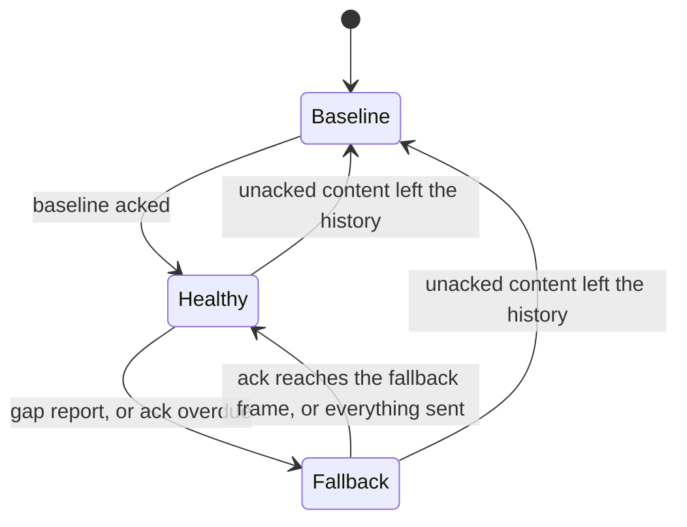

# Replication

How `ServerWorld` maintains a client's encoded replicated view over an unreliable, unordered
datagram channel, and what it costs. This is the architecture; the guides for the people who use it
are [Sessions](../lib/vecs-server/docs/sessions.md) (server),
[Client world](../lib/vecs-client/docs/client-world.md) (client) and
[Frames](../lib/vecs-protocol/docs/frames.md) (wire).

## The invariant

The server numbers every frame. A **diff** `(from, to]` says what changed after frame `from`, up to
and including frame `to`, with each component appearing once at its latest value. The client's
**accepted version** is the newest `to` it has accepted into its receive buffer, and it acks that
number. The exact replication state at a frame is the encoded per-session view reconstructible by
applying accepted diffs through that frame. It is not literal equality with server memory or with the
client's rendered ECS: the client applies discrete state on pulls, may render at fractional
`renderFrame` between applied frames, and may have derived client-local components.

The state claim is inductive under in-order delivery or once a diff's dependencies have arrived. An
applicable new diff has `from <= acceptedVersion < to`; overlapping changes are replaced by their
newer values. Stale frames do not roll the accepted version or applied state backward. Resets compose
with merged diffs and apply once, only when newer than the applied state at the start of the pull.
A marked optimistic packet may be received but held, so receipt is not acceptance. An ordinary diff
with `from > acceptedVersion` is a protocol error: the client closes with
`CLOSE_PROTOCOL_ERROR_CODE` (#213).

The server cannot know the client's version, only its newest ack, which is at or behind it. A delta
from the ack is therefore always safe. That is the default, and everything below builds on it.

## Plain deltas, and what they cost

Each frame a session gets `history.pull(ack, frame)`: every change in `(ack, frame]`, merged out of
the session's history window (#216). A baseline (`fromFrame` 0, the whole view) replaces a delta when
the client cannot be caught up with one, and while a baseline is in flight the server sends no state.
A frame whose diff is empty is not sent unless it carries RPC traffic, or a keepalive is due
([below](#the-keepalive)).

The price is redundancy. The ack lags the frame by a round trip, `L` frames, and a change that is not
superseded by a later one may be sent up to `L + 1` times before its ack arrives; an ack can stop
repetition earlier, later values supersede earlier ones, and baseline fallback can send additional
copies. At 30 Hz and a 200 ms round trip the upper opportunity count is about 7. Changes that are
superseded cost nothing extra, because the merge keeps one value per component, so the waste is in
changes that happen once and then sit still, such as the baseline of a dead-reckoned body.

## The optimistic base

`ServerWorldOptions.redundancyFrames` (`R`, an integer of at least 1 and less than `historyFrames`)
opts in to sending each frame as a delta from a **base** later than the ack:

```text
base  = max(ack, the state frame of the send R sends ago)
diff  = history.pull(base, frame)
```

A **send** is a frame in which the session was sent a baseline or a delta with content, or, with
`keepAliveFrames`, a [keepalive](#the-keepalive). Frames that sent nothing because their diff was
empty, or were withheld while a baseline was in flight, are not sends. The **state frame** of a send
is the newest frame at which the session's replicated state had changed as of that send: the
`toFrame` of the newest per-frame diff with content that the server recorded into the session's
history (`History.lastContentFrame`). A send that carries a new change names its own frame. A diff
with only an entity reset is content too: it changes the state frame, has up to `R` send
opportunities subject to ack and supersession, and arms the liveness probe. A reset is never a
header-only keepalive.
A send that only carries a change again, or carries nothing, names the earlier frame where the state last
changed. The frame carries the **optimistic marker** (a field on `Server2Client`) exactly when
`base > ack`. Unset, the base is the ack, nothing is marked and the wire is byte for byte what it
always was.

- **The state is the same from a send's state frame to the send.** Nothing changed in between, so
  the client that holds the send holds the state frame, and a delta from the state frame holds
  exactly what one from the send would: `(stateFrame, frame]` and `(sendFrame, frame]` merge the same
  changes, with no extra bytes. The base is therefore a frame the client holds whenever it received
  that send or any later one, and the claim never depends on a frame that carried nothing.
- **The redundancy is counted in sends.** With in-order delivery (or once dependencies arrive), the
  client holds the base, or a newer frame, unless all of the last `R` sends carrying a change it
  lacked were lost. Up to `R - 1` such losses are absorbed however far apart in time the sends were:
  `R = 1` offers one send, `R = 2` can absorb one lost send, and `R = 3` two. Reordering can instead
  hold a marked diff until its dependencies arrive, with zero loss. In a view that changes on every
  frame each frame is a send with its own state frame, and the base is `frame - R`.
- **A lost send that carried nothing the client lacked costs nothing at all.** A keepalive, or the
  repeat of a change the client already holds, names the state frame of the change before it, which
  the client holds, so losing it never moves a base past what the client holds. Take `R = 2` and sends
  at 100 (a change), 101 (its repeat) and 102 (a keepalive): the delta of 103 starts at 100, the state
  frame of the send two back, and a client that lost 101 and 102 is at 100 and applies it. Naming the
  frame of the send, 101, would read as a gap, though 100 carried everything.
- **A change has up to `R` consecutive send opportunities, however sparse the traffic.** A change
  made in frame `c` is sent, and the next `R - 1` sends can carry it because their bases are still
  before `c`. An ack can stop those repeats sooner, and later values can supersede it. The send after
  those starts at `c` and no longer carries it. Fallback can send additional copies.
- **`ack` floors the base**, so a diff never starts before the ack. `R` counts sends, not history
  slots: in sparse traffic the state frame of a send can precede many empty frames, so a pull may
  merge more than `R` frames. `historyFrames` (`H`) bounds available history; if required content
  has been evicted the server sends a baseline. Frames since the base that sent nothing hold nothing,
  so they add nothing to the diff. A view that has not changed since the ack has nothing to presume: every
  ring entry is at or before the ack, the base is the ack, and its keepalives are plain deltas.
- **A baseline needs no special case.** It is a send, and the ack floor does the rest. The baseline
  being in flight makes the session unhealthy, so no state is sent, and once it is acked the ack is
  the baseline's frame. The base starts there and moves up as sends follow the baseline, so the delta
  that ends the wait carries everything withheld while the baseline was in flight. The first `R`
  sends after a baseline are therefore from the baseline, and not optimistic.

Two designs came before this one. Choosing the base by frame number, `max(ack, min(frame - R, newest
send))`, patched two symptoms of a frame number, the first change after a quiet stretch and the delta
that ends a baseline wait, but not the cause: between the two bounds the base is still often a frame
that was not sent. On the simulated link below (seed 1, 60 s, one entity changing every fourth frame)
it made `R = 2` send 54% of the unset run's bytes with 89 gap reports, against 44% and 8 with the
base on state frames. Choosing the base by the frame of the send, the design this replaces, fixed
that but named a frame that can carry nothing the client lacked. With the keepalive that is every
frame of an idle view: a lost keepalive, or `R` of them in a row, became the base of the next frame,
and a client still at the previous change read it as a gap. An idle view over the same link reported
279 gap reports a minute at `R = 1` and 28 at `R = 2` for nothing it was missing.

The marker is what makes the presumption safe to state. A marked diff says: _I assumed you hold
`base`; if you do not, this is not a protocol error._

### When the server is optimistic

Only while the session is **healthy**. Otherwise the base is the ack.

| Condition for healthy                                      | Why                                                     |
| ---------------------------------------------------------- | ------------------------------------------------------- |
| The session has acked a baseline                           | Before that the client holds nothing to presume on.     |
| No baseline is in flight or needed                         | The client is about to reset; #216 owns that handshake. |
| No fallback is running                                     | See below.                                              |
| The ack is not overdue: the liveness timer has not expired | See below.                                              |



## When the presumption is wrong

The client does not yet have a frame the base presumed, because the relevant sends were lost or a
frame was reordered behind one built on it. Reordering alone can cause a hold without any loss.
Three mechanisms cover it.

**The client holds the diff.** A marked diff with `from > version` is put in a bounded set of held
diffs (`MAX_HELD_DIFFS`, 8: about a round trip of frames at 30 Hz, and a full set drops its oldest,
which is harmless because the fallback supersedes whatever is held). As soon as `version >= from` it
is applied, and a held diff is dropped once `version >= to`. A late or reordered frame therefore
heals the gap with no round trip. An unmarked diff with `from > version` is still a protocol error.

Resets carried by held diffs wait with their snapshots. Once released, they apply only if their
frame is newer than the rendered state at the start of the pull, not the received `version`:
release advances that version before the world applies the reset. Overlapping deltas keep the
newest reset per eid and destroy it once. See [State diffs](../lib/vecs-protocol/docs/state-diffs.md).

**The client reports the gap.** Holding a diff sets a flag. The next `send()` carries
`Client2Server.gap` if a diff is still held at that moment and clears the flag; a gap that closed
before the ack went out is not reported. Each further held diff raises the flag again, so a report
the link lost is repeated by the next frame.

**The server falls back.** A gap report makes the session's base the ack, from the next frame
(`fallbackFrame`), until the ack reaches `min(fallbackFrame, newest)`, where `newest` is the state
frame of the newest send, the last change that was ever sent: the client has caught up with the frame
the fallback began at, or already holds everything that was ever sent. The second condition keeps a
fallback begun in a quiet moment, when its first frame is empty and the ack can never reach it, from
lasting until the next change has been sent and acked. Because it is a state frame, a keepalive or
the repeat of an older change does not move it: a quiet view's fallback ends when the client has the
last change, not when it has acked the latest keepalive. A report that arrives while a fallback
runs is ignored, so reports repeated once per ack do not extend it. A report that arrives during a
baseline handshake starts a fallback that the baseline's ack ends at once.

## Liveness: the ack timeout

A loss that nothing follows is invisible to the client: a change is lost in all `R` frames that carry
it, it ages out of their window, nothing else changes, and no later frame shows a gap. A gap report that
the link lost, or a client stuck behind a hole, ends the same way. So the server also watches the
ack.

The session keeps a **probe**, a sent content state frame still unacked, and
when it was sent or retargeted. It is a state frame like the ring's entries, so the repeat of a change the client
has already acked never arms it: an ack that reaches the change satisfies it, and the loss of a
repeat is nothing to chase. Once the ack has not reached the probe for longer than the **ack
timeout** the session falls back exactly as for a gap report. New content sends leave an unacked
probe alone. When an ACK covers it, the server immediately retargets it to the newest sent content
state frame still above the ACK, restarting the timer at the ACK's arrival; if none remains, it
disarms. A stale or duplicate ACK never restarts the timer. Fully acked sessions and keepalives alone
never arm it. The timeout is the one baselines in flight already use: twice the session's smoothed ack
round trip, at least 100 ms, and 1 s before the first sample (`RttEstimator`, RFC 6298 style, no new
constants). A lost change is chased within the ack timeout of the later of its send and the ACK
that covered the previous probe, plus the next send tick. The fallback delta arrives one link delay
later if its content remains in history; if required history has been evicted, the server falls back
to a baseline instead.

The ring operations are allocation-free. Per session the ring stores the last `R` state frames.
Server sessions keep scalar probe/fallback fields even when redundancy is unset, and each client
`DiffBuffer` has an empty held-diff array even when no diff is held. Diffs, merges, snapshot decoding
and encoding can allocate.
Retargeting reads `SentFrames.newest` in O(1): content sends
push `History.lastContentFrame`, repeats and keepalives push that same state frame, and RPC-only
sends never push. A keepalive can only be sent after the current content has been sent (none goes
out while a baseline is needed or in flight), so it cannot advance the newest entry beyond sent
content. Initial ring padding is at or below the ACK. No extra scalar or per-send timestamps are
needed. The state frame is read from one integer the history keeps for
every session, `lastContentFrame`, written once per frame recorded, which is also what lets a pull
that starts at or after it answer an empty delta without merging a slot. Reading the base is one load.
A world that does not set `redundancyFrames` allocates no ring; scalar session bookkeeping remains.

## Cost and trade-off

A change has up to `R` send opportunities instead of up to `L + 1`, whatever the lag. An ack can
stop repeats earlier, a later value can supersede it, and fallback can add copies. The stall risk is
when all `R` sends carrying a change the client lacks are lost: its view stops until the fallback delta reaches it, about one
round trip after the gap was detected, and about the ack timeout plus a link delay when the report or
the tail was lost. The client's interpolation buffer, three frames by default, hides part of it.
Running this on the simulation harness (`lib/vecs-server/tests/lossy_replication.test.ts`: a 200 ms
round trip, 5% loss each way, reordering, 60 s, 40 entities, seed 1) gives, as a share of the bytes
sent with `R` unset:

| `R` | Every component changes every frame | Three entities change per frame | One entity changes every fourth frame |
| --- | ----------------------------------- | ------------------------------- | ------------------------------------- |
| 1   | 78%                                 | 53%                             | 31%                                   |
| 2   | 81%                                 | 39%                             | 44%                                   |
| 3   | 90%                                 | 51%                             | 62%                                   |

and, for the stalls of the client's view:

| `R` | Stalls, three entities per frame | Late changes, one entity every fourth frame |
| --- | -------------------------------- | ------------------------------------------- |
| 1   | 45 (mean 267 ms, max 333 ms)     | 32 of 435 (slowest 567 ms)                  |
| 2   | 4 (mean 308 ms, max 333 ms)      | 4 of 435 (slowest 467 ms)                   |
| 3   | none                             | none                                        |

A stall is the client's accepted version standing still for more than one frame interval longer than
the longest it ever stood still with `R` unset on the same seed (100 ms here). That measures a view
that changes on every frame. In the sparse workload the view also stands still for the quiet between
changes, so the harness counts the changes that were late instead: those that reached the client more
than one frame interval later than the slowest change with `R` unset (167 ms here), counting from the
frame the server made them in. In the first workload a resent change is superseded by the next
frame's, so plain deltas are no larger than one frame's and only the cost of `R` copies and of
fallbacks shows. The second and third are the case this design is for: a change that happens once is
not superseded, and plain deltas resend it for a round trip. `R` = 1 saves the most per frame and
pays for it in fallbacks, each of which sends plain deltas for a round trip; `R` = 2 is the knee;
`R` = 3 buys the absence of stalls at this loss rate, at a higher steady cost.

## The keepalive

A session whose diff is empty is sent no frame (#216), and for the data that is right: the client
holds the server's state at its version and nothing is missing. But the client's `renderFrame`, the
frame it renders, advances only by applying frames, and when its buffer is dry it holds at the newest
frame applied. Whatever the client derives from `renderFrame` instead of from data stands still with
it and jumps when the next frame arrives. Dead reckoning is the case that matters: a `Motion`
baseline is extrapolated at `renderFrame`, and a scene of bodies that drift between corrections
replicates nothing for seconds. In Space Rocks, with a parked ship and drifting rocks, that was holds
of up to 3.5 s and jumps of about 3 m. A scene that changes on every tick sends a frame every tick
and never notices.

`ServerWorldOptions.keepAliveFrames` (`K`, an integer of at least 1) opts in to a **keepalive**: a
session that holds an acked baseline and has not been sent a frame with a diff for `K` frames is sent
one whose diff is empty. `DeadReckonedModule` requires it and throws at install without it. Unset,
the code path is one branch and the wire is byte for byte what it was.

- **It is a plain delta that happens to be empty.** It is labeled by the normal base selection: the
  ack, or with `redundancyFrames` the optimistic base, with the marker when that is past the ack. The
  client applies it, its version and `renderFrame` advance, and it acks it like any frame.
- **It counts as a send, with the state frame of the last change.** The client was sent it and its
  version may be that frame, so it joins the ring like any other send. It carries nothing, so its
  state frame is the one the send before it named, never a frame the client may lack: a lost keepalive
  cannot become the base of a later frame that the client cannot apply. An idle view that has been
  acked therefore has a base at or before its ack, and its keepalives are plain deltas from the ack.
- **It is not content for the liveness probe.** Nothing in it needs delivering, so a lost one is never
  chased with a fallback.
- **It is never sent while a baseline is in flight or needed**, and not before a baseline has been
  acked: the session has no state to build a delta on, and #216 sends it none. The delta the
  server builds is `undefined` then, and a keepalive needs a delta.
- **Only a frame with a diff restarts the count**, because only a frame with a diff advances the
  client's `renderFrame`. A frame with content or a delta that merely rides with RPC traffic does; an
  RPC-only frame, as while a baseline is in flight, has no diff and does not.
- **A busy session is unaffected.** A session sent a diff at least every `K` frames gets exactly the
  frames it gets without the option.

State per session includes `lastDiffFrame`, the newest frame sent with a diff, written once per frame
sent when `K` is set. A world that does not set the option keeps none of this counter and spends one
branch per frame sent, and one more per idle session. Constructing and encoding the frame can allocate.

### Pause idle sessions with a gate

Register `world.keepAliveWhile(dsl)` before the first session exists.
It requires `keepAliveFrames`; several registrations OR their DSLs.
On top of the existing cadence and baseline tests, a keepalive is wanted iff

```text
gateCount(view) > 0 || session.ackFrame < session.lastContentSendFrame
```

Every content send (baseline, content delta, or fallback resend) moves `lastContentSendFrame`.
Waiting for its ack preserves redundant carriers of the last change: with `R = 2`,
losing its first send is recovered by the following carrier before the pause.
Keepalives continue through lost acks; the server never pauses on a timer.
Content always resumes traffic, and query membership resumes the ordinary cadence.

The server's `DeadReckonedModule` registers a gate by default (`idleKeepAlive: true`).
Its server-local, `DontSnapshot` moving tag follows `Motion.rest`, changing only when
rest flips or the first baseline primes it. Set `idleKeepAlive: false` to keep the
continuous cadence. Client `blendMs` defaults to 100 ms, supports longer values,
and `0` disables blending.

A paused session is a `keepAliveFrames`-unset session: it is fully acked, the redundancy
ring contains state frames at or before the ack, and the liveness probe is disarmed.
Empty history frames never force a baseline. The client drains its buffer and holds;
its `renderFrame` is the clock of replicated state, not a clock for local effects.
All visible dead-reckoned baselines are at rest. Motion correction blends, first-baseline
blends and hand-off fades run on render-loop time, advanced once per `progress(now, delta)`
in milliseconds. They complete even while `renderFrame` holds. After a render-loop stall,
the client may receive and acknowledge the entire change before applying it; its blend
still completes as the render loop resumes, with no further downstream frame needed.
The existing motion system advances one module-level blend clock in its `run` callback,
before either per-entity system samples it, adding no per-entity lookup or allocation.
On resume,
the existing buffer sweeps to the next frame over its buffer depth. The first moving
baseline can be applied up to one frame late and then blends like any late correction,
without a visible jump. The pre-existing compaction race is tracked in
[#271](https://github.com/vworlds/vecs/issues/271). No wire or buffer change is needed here.

There is no scan: each distinct view/gate combination gets one shared `TrackerCache`
query, without a listener, released alongside the view tracker. Structural mutations
maintain its count. The empty-send branch reads that integer and the ack/content-send integers;
content sends write one send-frame integer. No gate creates no extra query and preserves bytes.
Once the last content send is acknowledged, idle downstream traffic is zero rather
than 30 packets/s at `K = 1`; moving sessions retain the existing cadence.

### Cost

A header-only frame per `K` ticks for each session that would otherwise be sent nothing: the diff
tag, `toFrame` and `fromFrame` as varints and two zero counts, plus a byte when marked optimistic.

| Frame number | Below 128 | Below 16 384 (9 min at 30 Hz) | Below 2 097 152 (19 h) | Beyond |
| ------------ | --------- | ----------------------------- | ---------------------- | ------ |
| Payload      | 5 B       | 7 B                           | 9 B                    | 11 B   |

At 30 Hz and `K` = 1 that is 150 to 330 B/s per idle client (5–11 payload bytes per frame), excluding
transport and ACK overhead. On
the dead-reckoning bandwidth test (200 drifting bodies, one client) it is 732 B/s against 102 146 B/s
streamed.

The wire is the only cost, and it is the same with or without `redundancyFrames`: an idle view has
nothing for the redundancy to protect, and a keepalive that is lost carries no state, so it can never
leave the client missing anything. Running an idle view of 20 entities on the simulation harness
(200 ms round trip, 5% loss each way, reordering, 60 s, seed 1) with `K` = 1:

| `R`   | Frames | Bytes  | Gap reports | Standstills over 100 ms (longest) |
| ----- | ------ | ------ | ----------- | --------------------------------- |
| unset | 1817   | 12.7 K | 0           | none (100 ms)                     |
| 1     | 1817   | 12.7 K | 0           | none (100 ms)                     |
| 2     | 1817   | 12.7 K | 0           | none (100 ms)                     |
| 3     | 1817   | 12.7 K | 0           | none (100 ms)                     |

Seed 2, which loses the first baseline, gives the same: 1786 frames, 12.8 K, no gap reports and no
standstill at any `R`. When the base was the frame of the send, a keepalive was the base of the next
frame, and the same run reported 279 gap reports and 46 standstills (longest 333 ms) at `R` = 1, 28
and 7 at `R` = 2, and 14.1 K, 14.5 K and 14.5 K of bytes at 1, 2 and 3. A gap report needs a change
the client lacks, so an idle view reports none, and a view that changes now and then reports only
those that losing a change causes. With one entity changing every fourth frame and `K` = 1 (seed 1),
the reports go from 279 to 116 at `R` = 1, from 28 to 6 at `R` = 2, and stay none at `R` = 3, and the
bytes fall by 13%, 2% and 1%. A link that loses nothing has no gap reports at `R` of 1, 2 or 3
(`lib/vecs-server/tests/lossy_replication.test.ts`).

A larger `K` saves bytes and makes the client wait: its interpolation buffer spans one missing frame
on a steady link, so `K` = 2 still renders smoothly, but from `K` = 3 the render frame stalls between
keepalives and jumps at the next. `K` = 1 is the safe value, and the one dead reckoning documents.

### Render-clock characterization (#257)

PR #272 characterizes the current clock without changing production code. Run the seeded matrix:

```bash
node lib/vecs-phaser-server/tests/render-clock-matrix.mjs
```

The [harness methodology](../lib/vecs-phaser-server/tests/harness/README.md) defines the 367 selected
scenarios, skipped combinations, and JSON fields. Measurements use actual fractional
`ClientWorld.renderFrame` and independently recorded server physics poses. Runs last 30 s, excluding
2 s of warmup; scheduler-mismatch diagnostics last 60 s, phase diagnostics 6 s. Unless specified,
tables use 100 ms RTT, 60 Hz rendering, seed 257, gate on, and redundancy unset. Holds are episodes,
with durations in server ticks (including fractional ticks), not rounded render-frame counters.
Position errors are meters at rendered time; these isolated straight-line bodies do not rotate.
Zero error does not imply smooth playback or low latency.

#### 1. The K = 2 hold

| K = 2 condition                                      | Holds | Longest, ticks | Compactions | Diagnosis                                       |
| ---------------------------------------------------- | ----: | -------------: | ----------: | ----------------------------------------------- |
| Clean, matched 30 Hz server, 60 Hz renderer          |     0 |              0 |           0 | Smooth for this phase                           |
| Clean, matched server, 59 Hz renderer                |     0 |              0 |           0 | Renderer phase drift alone did not cause a hold |
| Clean, matched server, 20/200 ms RTT                 | 0 / 0 |              0 |           0 | Constant latency alone did not cause a hold     |
| Jitter, 0–40 ms extra each direction                 |     0 |              0 |           0 | This seeded jitter fits the delay cushion       |
| One downstream send lost every 47 sends              |     9 |              1 |           0 | Newest-received-frame cap                       |
| 300 ms downstream loss every 5 s                     |     6 |              7 |           0 | Newest-received-frame cap                       |
| Actual server 29.8 Hz, client configured 30 Hz, 60 s |    13 |           1.49 |           0 | Arrival/scheduling-rate mismatch reaches cap    |

The mismatch reproduces an approximately five-second one-tick hold: the first two start at
4897.224 and 9730.557 ms; later starts at 22213.891, 27247.224, and 32213.891 ms are approximately
five seconds apart. Intervening refill/recovery changes the cadence and sometimes produces
half-tick or 1.5-tick episodes. It is not a strictly periodic five-second oscillator.

Pull-by-pull trace of its first hold (milliseconds; `slots` are diff endpoints):

| Pull time | Frame before → after | Received version | Slots before | `_tServ` before | Dry |
| --------: | -------------------- | ---------------: | ------------ | --------------: | --- |
|  4830.557 | 140 → 140.5          |              141 | 141, –, –    |        4847.224 | no  |
|  4847.224 | 140.5 → 141          |              141 | 141, –, –    |        4847.224 | no  |
|  4863.891 | 141 → 142            |              143 | 143, –, –    |        4880.557 | no  |
|  4880.557 | 142 → 143            |              143 | 143, –, –    |        4880.557 | no  |
|  4897.224 | 143 → 143            |              143 | –, –, –      |        4913.891 | yes |
|  4913.891 | 143 → 143            |              143 | –, –, –      |        4997.224 | yes |
|  4930.557 | 143 → 143.333        |              145 | 145, –, –    |        5013.891 | no  |
|  4947.224 | 143.333 → 143.667    |              145 | 145, –, –    |        5013.891 | no  |
|  4963.891 | 143.667 → 144        |              145 | 145, –, –    |        5013.891 | no  |

The two held render samples span 33.333 ms, or 0.9933 actual server ticks. The frame is already
at `version`, the bucket is empty, and there was no `_accept` compaction. The 0.2-frame/s mismatch
consumes approximately one nominal frame of timing margin per five seconds. Matched-clock runs
accumulate only about `1e-11` frames of floating-point timing error in 30 s; rounding can decide
a boundary race but cannot account for this magnitude or cadence.

**Conclusion:** a K = 2 hold can arise from the normal cap after arrival-rate drift or loss, without
#271. This does not prove which event caused the original SpaceRocks hold: its actual server/arrival
timestamps were not supplied. Clean matched clocks did not reproduce that observation. The harness
distinguishes these mechanisms rather than attributing the playtest symptom to an unproven defect.

#### 2. The #271 compaction defect

| Evidence                                         | Production buffer                               | Test-only two-slot refill                      |
| ------------------------------------------------ | ----------------------------------------------- | ---------------------------------------------- |
| Resume, K = 1, 40 ms RTT, 59 Hz renderer, seed 4 | First moving frame 121 rendered at 122.05085    | Rendered at 121.03390                          |
| First-baseline application time                  | 4154.417 ms                                     | 4120.519 ms                                    |
| Measured compactions                             | 1                                               | 0                                              |
| Resume position error, mean / p95 / max          | 0.001002 / 0 / 0.068362 m                       | 0 / 0 / 0 m                                    |
| Eight phase seeds, 40 ms RTT                     | 1 of 8 late first baselines at each of 60/59 Hz | Seed-4/59-Hz control resolves first-frame race |

The non-boundary 59 Hz trace confirms the issue's analysis:

|                     Event time | Bucket/base                           |               Deadline | Applied/rendered                      |
| -----------------------------: | ------------------------------------- | ---------------------: | ------------------------------------- |
|               4086.621 ms pull | [121, –, –], base 121                 |            4152.722 ms | applied 1; rendered 41.67797          |
|               4103.570 ms pull | [121, 122, –], base 121               |            4152.722 ms | applied 1; rendered 62.01695          |
|               4120.519 ms pull | [121, 122, 123], base 121             |            4152.722 ms | applied 1; rendered 82.35593          |
|               4137.468 ms pull | [121, 122, 123], base 121             |            4152.722 ms | applied 1; rendered 102.69492         |
| 4153.333 ms arrival, frame 124 | compacts to [122, 123, 124], base 122 | unchanged, 4152.722 ms | first frame's content folded into 122 |
|               4154.417 ms pull | [122, 123, 124], base 122             |            4152.722 ms | applied 122; rendered 122.05085       |

The arrival is 0.611 ms **after** the deadline, and the pull 1.695 ms after it. No floating-point
equality is needed. A three-slot bucket waits three ticks after its last dry pull, so four arrivals
can beat the first applying pull. Compaction advances `_base` without `_tServ`, discarding the
first frame's presentation opportunity. The resumed baseline is then classified as late and blended.
At 60 Hz the same seed additionally exposes a rounded deadline boundary, but that is not required.

The minimal expected-failing regression is
`lib/vecs-client/tests/render_clock_defects.test.ts`: dry pull at 0, endpoints 120/121/122, pull at
90 ms, endpoint 123 before the 110 ms pull. First applied frame is 121 rather than 120. Its two
pulls are deliberately away from the current deadline. The assertion also permits a fix that
applies 120 at the earlier pull.

This is a **second mechanism**, not the cause of the compaction-free K = 2 mismatch trace. The
test-only shorter refill validates one remedy's first-frame effect; advancing the timeline after
already folding the frame cannot by itself restore that lost interpolation sample. No remedy is
selected or implemented in production here.

#### 3. Intrinsic cap and local timing costs

Clean drifting scene, 28 measured seconds:

|   K | Holds / longest ticks | Mean rate / worst deviation | Jumps >1.5 frames/tick | Delay mean [min, max] | Compactions / dry pulls |
| --: | --------------------- | --------------------------- | ---------------------: | --------------------- | ----------------------- |
|   1 | 0 / 0                 | 1.00000 / <1e-12            |                      0 | 3.75 [3.5, 4]         | 0 / 0                   |
|   2 | 0 / 0                 | 1.00000 / <1e-12            |                      0 | 4.75 [4.5, 5]         | 0 / 0                   |
|   3 | 140 / 2               | 1.00060 / 2                 |                    278 | 4.252 [3, 5]          | 1 / 537                 |
|   4 | 210 / 1               | 0.99980 / 1                 |                      0 | 5.25 [4.667, 6]       | 0 / 420                 |
|   8 | 105 / 5               | 0.99901 / 1.667             |                    629 | 7.25 [5, 10]          | 0 / 1050                |

Every measured hold in all 367 scenarios occurs at the accepted-version cap (within `1e-8`
frames). The cap is intrinsic; whether a particular hold reaches it depends on refill delay,
buffer capacity, link timing, and local timing defects. K = 3 is not a theorem that every capped
clock must stall: a deeper, more delayed interpolation clock could keep future received frames
available. These are measurements of the current three-slot design.

Clean-run delay endpoint changes are −0.5, −0.5, −1, −0.333, and +0.333 frames for K = 1/2/3/4/8;
the half-tick server sampling phase and refill cycles explain these bounded endpoint differences.
All drifting-body mean/p95/max errors are zero at rendered time. Adding one constantly streamed
body makes all five K values smooth on the clean link: no holds or compactions, mean rate 1,
delay 3.75 frames, and streamed error at floating-point noise (`max < 4e-15` m).

|   K | Longest hold: jitter / isolated loss / burst loss, ticks | Counterfactual two-slot refill: holds / longest ticks / mean delay |
| --: | -------------------------------------------------------- | ------------------------------------------------------------------ |
|   1 | 0 / 1 / 8                                                | 0 / 0 / 3.75                                                       |
|   2 | 0 / 1 / 7                                                | 168 / 1 / 3.55                                                     |
|   3 | 3 / 5 / 9                                                | 280 / 1 / 4.25                                                     |
|   4 | 4 / 5 / 9                                                | 210 / 2 / 4.75                                                     |
|   8 | 6 / 13 / 13                                              | 105 / 6 / 6.75                                                     |

Shortening refill removes the demonstrated resume race but reduces arrival cushion and can
**increase** sparse-clock cap holds. It is not evidence of a fully fixed clock. K = 4/8 clean
holds already occur with zero compactions, so fixing #271 alone cannot remove them. K = 2 needs
no extrapolation on the tested matched clean link, but remains sensitive to clock-rate mismatch
and loss. An estimate for a complete timeline fix is therefore bounded by these controls, not a
claim of smoothness for every K after one patch.

For K = 2, render pauses of 100/500/2000 ms produce 1/7/29 compactions, then one cap hold of
1/1/1.5 ticks after rendering resumes. DR error remains zero on the constant-velocity path.
The intentional paused period has no rendered samples; its elapsed time appears in the first
resumed rate measurement rather than being mislabeled as a sampled hold.

Periodic correction controls have DR mean errors of about 0.001012/0.000952/0.000417/0.000298/0.000060 m
for K = 1/2/3/4/8; p95 is zero, and maxima are 0.2/0.2/0.2/0.2/0.1 m. Across their fault runs,
the largest mean is 0.00272 m, p95 remains zero, and max is 0.200001 m. The brief error includes
the convention of interpolating recorded truth across a teleport while DR retains its prior
baseline until the correction frame. Constant-velocity streamed loss tests remain nearly exact;
they do not bound error for curved paths or acceleration. The seed-4 resume transient above is
the demonstrated defect's visible pose consequence.

#### 4. Cost of the status quo

Downstream wire payload per session after warmup; transport and ACK overhead excluded:

|   K | Moving DR, either gate: packets/s; B/s | Idle, gate off: packets/s; B/s | Idle, gate on: packets/s; B/s | Mixed moving scene: packets/s; B/s (R unset / 2) |
| --: | -------------------------------------- | ------------------------------ | ----------------------------- | ------------------------------------------------ |
|   1 | 30; 205.07                             | 30; 205.07                     | 0; 0                          | 30; 595.07 / 625.14                              |
|   2 | 15; 102.50                             | 15; 102.50                     | 0; 0                          | 30; 595.07 / 625.14                              |
|   3 | 10; 68.36                              | 10; 68.36                      | 0; 0                          | 30; 595.07 / 625.14                              |
|   4 | 7.5; 51.25                             | 7.5; 51.25                     | 0; 0                          | 30; 595.07 / 625.14                              |
|   8 | 3.75; 25.64                            | 3.75; 25.64                    | 0; 0                          | 30; 595.07 / 625.14                              |

Moving-DR and idle costs are identical for redundancy unset/2. The gate changes neither moving
case; a resting, acknowledged scene pays zero. The mixed scene continuously sends content,
so K does not reduce its packet rate. R = 2 changes delta bases/markers and payload bytes there.
The window crosses frame 128, hence slightly less than 7 B per header-only packet on average.

For periodic corrections at R unset, packet rates for K = 1/2/3/4/8 are
30/15.643/10.643/8.321/4.643 per second, with 246.07/147.93/113.64/97.79/72.61 B/s. Content resends
and corrections make the rate exceed the pure keepalive cadence. Full R = 2 and recovery
measurements are in the per-scenario JSON, not inferred from a header-size formula.

#### Clock options, without selecting one

| Option                                                     | Cost                                                                                                                                            | Leaves unsolved / policy needed                                                                                                                                            |
| ---------------------------------------------------------- | ----------------------------------------------------------------------------------------------------------------------------------------------- | -------------------------------------------------------------------------------------------------------------------------------------------------------------------------- |
| Fix startup delay/capacity and keep timeline/base coherent | Local interpolation change; no new wire bytes                                                                                                   | Does not remove cap under loss/rate mismatch; shorter refill can worsen holds; requires #271 before/after matrix                                                           |
| Correct timeline-rate synchronization only                 | Arrival-rate estimator and controlled resynchronization/slew; additional clock bookkeeping                                                      | Does not restore folded history or render missing streamed state; sparse K still needs latency/buffer policy                                                               |
| K-aware deeper interpolation buffer                        | More stored history and approximately K-dependent presentation latency, potentially smooth on clean sparse arrivals                             | Loss/long pauses still exhaust received data; startup, compaction, and synchronization must remain coherent                                                                |
| Bounded presentation extrapolation horizon                 | Prediction/catch-up CPU, synchronization/recovery policy, explicit presentation-clock contract; saves up to 87.5% of header-only sends at K = 8 | Future streamed state does not exist; choose stream hold/prediction behavior, horizon exhaustion, gaps/baselines/reconnect/time discontinuities; keep ACK version separate |
| Keep K = 1 with idle gate                                  | About 30 moving-session packets/s, 205 B/s in this window; zero settled-idle downstream traffic                                                 | Conservative fallback; does not remove #271 or loss-induced holds                                                                                                          |

No clock option is selected here. The evidence narrows the local defect and shows the remaining
design trade-offs; it does not authorize a production clock rewrite.

### Future work

A sparse keepalive, `K` of 4 or more, would save most of the bytes of an idle session, but the client
cannot render it smoothly: `renderFrame` is the frame of the newest applied state, and it never runs
past it. A client clock that advances `renderFrame` past the newest frame by up to `K`, extrapolating
between keepalives instead of waiting, would let `K` grow, and dead-reckoned bodies would keep moving
for the frames a keepalive does not cover. Until then `K` = 1 is the value.

## Compatibility

The optimistic marker and gap report use `Server2Client` and `Client2Server` tags 6 and 7, absent
unless set. Entity resets add no message field: they ride in the diff's `removed` section as an
`ALL_COMPONENTS` cid followed by a frame-offset varint. **Build and deploy client and server
from the same commit.** There is no backward-compatibility path for the reset layout. Diffs
without resets retain their previous bytes, and a new client sends a gap only after a marked frame.

The keepalive adds no field. It is a delta with an empty diff, which every client accepts, and it is
marked optimistic only under `redundancyFrames`, so it needs no deployment order of its own.

## Source

| Concern                                                                | Where                                 |
| ---------------------------------------------------------------------- | ------------------------------------- |
| Keepalive: when it is due, what it records                             | `lib/vecs-server/src/server_world.ts` |
| Base, healthy test, fallback, probe, gap handling                      | `lib/vecs-server/src/server_world.ts` |
| The last `R` sends, the base's source                                  | `lib/vecs-server/src/sent_frames.ts`  |
| Window, merging `pull`, `lastContentFrame`, `validateRedundancyFrames` | `lib/vecs-server/src/history.ts`      |
| Smoothed ack round trip                                                | `lib/vecs-server/src/rtt.ts`          |
| Marker and gap fields                                                  | `lib/vecs-protocol/src/messages.ts`   |
| Held diffs, `takeGap`, `push(diff, optimistic)`                        | `lib/vecs-client/src/diff_buffer.ts`  |
| Gap flag on `send()`, marker on receive                                | `lib/vecs-client/src/client_world.ts` |
