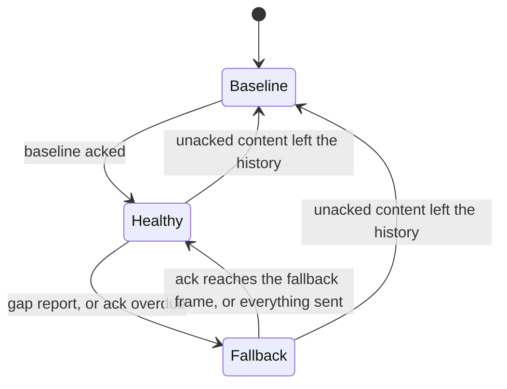

# Replication

How `ServerWorld` keeps a client's replicated state equal to its own over an unreliable, unordered
datagram channel, and what it costs. This is the architecture; the guides for the people who use it
are [Sessions](../lib/vecs-server/docs/sessions.md) (server),
[Client world](../lib/vecs-client/docs/client-world.md) (client) and
[Frames](../lib/vecs-protocol/docs/frames.md) (wire).

## The invariant

The server numbers every frame. A **diff** `(from, to]` says what changed after frame `from`, up to
and including frame `to`, with each component appearing once at its latest value. The client's
**version** is the newest `to` it has accepted, and it acks that number.

> A client at version `T` holds exactly the server's state at `T`.

It holds by induction, and one rule maintains it: the client accepts a diff only if `from <= version`.
The state at `version` is exact and the diff carries everything that changed after `from`, at its
value as of `to`. What changed in `(from, version]` is rewritten with that newer value, and nothing
is missing. A diff with `from > version` lacks what changed in `(version, from]`, so accepting it
would break the invariant for good. An ordinary diff like that is a protocol error: the client closes with
`CLOSE_PROTOCOL_ERROR_CODE` (#213).

The server cannot know the client's version, only its newest ack, which is at or behind it. A delta
from the ack is therefore always safe. That is the default, and everything below builds on it.

## Plain deltas, and what they cost

Each frame a session gets `history.pull(ack, frame)`: every change in `(ack, frame]`, merged out of
the session's history window (#216). A baseline (`fromFrame` 0, the whole view) replaces a delta when
the client cannot be caught up with one, and while a baseline is in flight the server sends no state.

The price is redundancy. The ack lags the frame by a round trip, `L` frames, and a change that is not
superseded by a later one stays in every frame's delta until its ack arrives: it is sent `L + 1`
times. At 30 Hz and a 200 ms round trip that is 7 times. Changes that are superseded cost nothing
extra, because the merge keeps one value per component, so the waste is in changes that happen once
and then sit still, such as the baseline of a dead-reckoned body.

## The optimistic base

`ServerWorldOptions.redundancyFrames` (`R`, an integer of at least 1 and less than `historyFrames`)
opts in to sending each frame as a delta from a **base** later than the ack:

```text
base  = max(ack, the frame the session was sent R sends ago)
diff  = history.pull(base, frame)
```

A **send** is a frame in which the session was sent a baseline or a delta with content. Frames that
sent nothing because their diff was empty, or were withheld while a baseline was in flight, are not
sends. The frame carries the **optimistic marker** (a field on `Server2Client`) exactly when
`base > ack`. Unset, the base is the ack, nothing is marked and the wire is byte for byte what it
always was.

- **The base is a frame the client was sent.** The client's version is always a frame it was sent, so
  a base the session never sent claims something false. A frame number such as `frame - R` is not a
  send once traffic is sparse. Take sends at 100, 101 and 106 and `R = 2`: `106 - 2` is 104, which was
  not sent, and the newest send at least two frames back is 101, which a client that lost it does not
  hold. It is at 100, and would read the delta as a gap even though `(100, 106]` carries everything.
  Two sends back is 100.
- **The redundancy is counted in sends.** The client holds the base, or a newer frame, unless it lost
  all of the last `R` sends. Up to `R - 1` lost frames in a row cost nothing, however far apart in
  time the sends were: `R = 1` sends every change once, `R = 2` survives any single lost frame, `R = 3`
  any two in a row. In a view that changes on every frame each frame is a send and the base is
  `frame - R`.
- **Every change is carried by `R` consecutive frames, however sparse the traffic.** A change made in
  frame `c` is a send, and so is each of the next `R - 1` frames, because their diffs still contain it.
  The diff of frame `c + R` starts at `c`, and no longer does. Changes that follow each other closely
  share the frames in between.
- **`ack` floors the base**, so a diff never starts before the ack and the pull never merges more
  frames than a plain delta would: `R` of them in a busy view, where a plain delta merges `L + 1`.
  Frames since the base that sent nothing hold nothing, so merging them costs a few empty slots and
  adds nothing to the diff.
- **A baseline needs no special case.** It is a send, and the ack floor does the rest. The baseline
  being in flight makes the session unhealthy, so no state is sent, and once it is acked the ack is
  the baseline's frame. The base starts there and moves up as sends follow the baseline, so the delta
  that ends the wait carries everything withheld while the baseline was in flight. The first `R`
  sends after a baseline are therefore from the baseline, and not optimistic.

Choosing the base by frame number instead, `max(ack, min(frame - R, newest send))`, is the design
this replaces. The cap on the newest send patches two symptoms of a frame number, the first change
after a quiet stretch and the delta that ends a baseline wait, but not the cause: between the two
bounds the base is still often a frame that was not sent. On the simulated link below (seed 1, 60 s,
one entity changing every fourth frame) it made `R = 2` send 54% of the unset run's bytes with 89 gap
reports, against 44% and 9 with the base on sends.

The marker is what makes the presumption safe to state. A marked diff says: _I assumed you hold
`base`; if you do not, this is not a protocol error._

### When the server is optimistic

Only while the session is **healthy**. Otherwise the base is the ack.

| Condition for healthy                                      | Why                                                     |
| ---------------------------------------------------------- | ------------------------------------------------------- |
| The session has acked a baseline                           | Before that the client holds nothing to presume on.     |
| No baseline is in flight or needed                         | The client is about to reset; #216 owns that handshake. |
| No fallback is running                                     | See below.                                              |
| The ack is not overdue: the liveness timer has not expired | See below.                                              |



## When the presumption is wrong

The client does not receive a frame the base presumed, because `R` frames in a row were lost, or a
frame was reordered behind the one built on it. Three mechanisms cover it.

**The client holds the diff.** A marked diff with `from > version` is put in a bounded set of held
diffs (`MAX_HELD_DIFFS`, 8: about a round trip of frames at 30 Hz, and a full set drops its oldest,
which is harmless because the fallback supersedes whatever is held). As soon as `version >= from` it
is applied, and a held diff is dropped once `version >= to`. A late or reordered frame therefore
heals the gap with no round trip. An unmarked diff with `from > version` is still a protocol error.

**The client reports the gap.** Holding a diff sets a flag. The next `send()` carries
`Client2Server.gap` if a diff is still held at that moment and clears the flag; a gap that closed
before the ack went out is not reported. Each further held diff raises the flag again, so a report
the link lost is repeated by the next frame.

**The server falls back.** A gap report makes the session's base the ack, from the next frame
(`fallbackFrame`), until the ack reaches `min(fallbackFrame, newest send)`: the client has caught up
with the frame the fallback began at, or already holds everything that was ever sent. The second
condition keeps a fallback begun in a quiet moment, when its first frame is empty and the ack can
never reach it, from lasting until the next change has been sent and acked. A report that arrives
while a fallback runs is ignored, so reports repeated once per ack do not extend it. A report that
arrives during a baseline handshake starts a fallback that the baseline's ack ends at once.

## Liveness: the ack timeout

A loss that nothing follows is invisible to the client: a change is lost in all `R` frames that carry
it, it ages out of their window, nothing else changes, and no later frame shows a gap. A gap report that
the link lost, or a client stuck behind a hole, ends the same way. So the server also watches the
ack.

The session keeps a **probe**, the oldest frame with content that is still unacked, and when it was
sent. Once the ack has not reached the probe for longer than the **ack timeout** the session falls
back exactly as for a gap report. The probe is rearmed by the next content frame sent after the ack
passes it. The timeout is the one baselines in flight already use: twice the session's smoothed ack
round trip, at least 100 ms, and 1 s before the first sample (`RttEstimator`, RFC 6298 style, no new
constants). A single content frame in flight is therefore found within the timeout plus a frame, and
the fallback delta arrives one link delay later.

State per session is a ring of the last `R` sends (`SentFrames`, `R` numbers allocated with the
session and written once per send) and three more values: `probeFrame`, `probeSentAtMs` and
`fallbackFrame`. Reading the base is one load, and nothing is allocated per frame. A world that does
not set `redundancyFrames` allocates no ring and keeps none of this.

## Cost and trade-off

A change costs `R` times its size instead of `L + 1`, whatever the lag. The price is paid when
`R` sends in a row are lost: the client's view stops until the fallback delta reaches it, about one
round trip after the gap was detected, and about the ack timeout plus a link delay when the report or
the tail was lost. The client's interpolation buffer, three frames by default, hides part of it.
Running this on the simulation harness (`lib/vecs-server/tests/lossy_replication.test.ts`: a 200 ms
round trip, 5% loss each way, reordering, 60 s, 40 entities, seed 1) gives, as a share of the bytes
sent with `R` unset:

| `R` | Every component changes every frame | Three entities change per frame | One entity changes every fourth frame |
| --- | ----------------------------------- | ------------------------------- | ------------------------------------- |
| 1   | 78%                                 | 53%                             | 31%                                   |
| 2   | 81%                                 | 39%                             | 44%                                   |
| 3   | 90%                                 | 51%                             | 63%                                   |

and, for the stalls of the client's view:

| `R` | Stalls, three entities per frame | Late changes, one entity every fourth frame |
| --- | -------------------------------- | ------------------------------------------- |
| 1   | 45 (mean 267 ms, max 333 ms)     | 32 of 435 (slowest 567 ms)                  |
| 2   | 4 (mean 308 ms, max 333 ms)      | 4 of 435 (slowest 467 ms)                   |
| 3   | none                             | none                                        |

A stall is the client's accepted version standing still for more than one frame interval longer than
the longest it ever stood still with `R` unset on the same seed (100 ms here). That measures a view
that changes on every frame. In the sparse workload the view also stands still for the quiet between
changes, so the harness counts the changes that were late instead: those that reached the client more
than one frame interval later than the slowest change with `R` unset (167 ms here), counting from the
frame the server made them in. In the first workload a resent change is superseded by the next
frame's, so plain deltas are no larger than one frame's and only the cost of `R` copies and of
fallbacks shows. The second and third are the case this design is for: a change that happens once is
not superseded, and plain deltas resend it for a round trip. `R` = 1 saves the most per frame and
pays for it in fallbacks, each of which sends plain deltas for a round trip; `R` = 2 is the knee;
`R` = 3 buys the absence of stalls at this loss rate, at a higher steady cost.

## Compatibility

Both fields are new `Server2Client` and `Client2Server` tags (6 and 7), absent unless set. A decoder
that predates them rejects the tag, so a server with `redundancyFrames` set must only serve clients
that understand the marker: deploy clients first. A server without it sends nothing a client of any
version cannot read, and a new client sends the gap field only after receiving a marked frame.

## Source

| Concern                                            | Where                                 |
| -------------------------------------------------- | ------------------------------------- |
| Base, healthy test, fallback, probe, gap handling  | `lib/vecs-server/src/server_world.ts` |
| The last `R` sends, the base's source              | `lib/vecs-server/src/sent_frames.ts`  |
| Window, merging `pull`, `validateRedundancyFrames` | `lib/vecs-server/src/history.ts`      |
| Smoothed ack round trip                            | `lib/vecs-server/src/rtt.ts`          |
| Marker and gap fields                              | `lib/vecs-protocol/src/messages.ts`   |
| Held diffs, `takeGap`, `push(diff, optimistic)`    | `lib/vecs-client/src/diff_buffer.ts`  |
| Gap flag on `send()`, marker on receive            | `lib/vecs-client/src/client_world.ts` |
