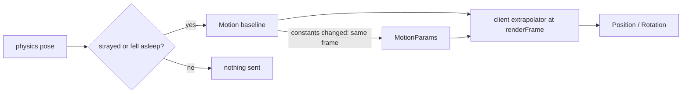

# @vworlds/vecs-phaser

Data-only package providing wire-serializable Phaser render components (`Position`, `Arc`,
`Text`, `Image`, …) and the `phaserNetworkComponents` protocol order. `Image` is the first
textured renderable and is protocol type 17. `OpenPath` (type 23) is a tag that leaves the stroke
of an `Arc` or `Polygon` open, for progress rings and polylines. No `phaser` dependency.

The protocol also includes `DrawIn` for native Phaser Container parenting and `DrawBy` for
computed scene-root parenting. Both are networked relationship classes. `DisplaySetupModule` and
`PhaserServerModule` configure them as single-target (`Exclusive`) relationships in their worlds;
client setup also makes `DrawBy` traversable, while `DrawIn` is not.

A `DrawBy` child follows its parent's `Position` only: the `Offset` is added as is and the child's
own `Rotation` stays independent. `InheritRotation` is an opt-in tag that puts the child in its
parent's local frame instead, so the `Offset` turns with the parent and the child's `Rotation` is
the parent's angle plus the tag's `angle`. The tag is a wire type but deliberately not part of
`phaserNetworkComponents`, because that list's order is the protocol and appending to it shifts the
wire ids of every application component listed after it. It is client-local by default; an
application that wants the server to set it lists it in its own network components, after its
existing ones.

Also exports the shared asset catalog schema (`AssetDescriptor`, `SpritesheetDescriptor`,
`AssetCatalog`) used by `@vworlds/vecs-phaser-server` to describe server-owned assets and by
`@vworlds/vecs-phaser-client` to load them before rendering.

## Dead reckoning

`Motion`, `MotionParams` and `MotionClock` let a client extrapolate a physics body instead of
receiving its pose every tick (#217). They split what the prediction needs by how often it changes:

| Component      | Holds                                                                                                                                    | Sent                                |
| -------------- | ---------------------------------------------------------------------------------------------------------------------------------------- | ----------------------------------- |
| `Motion`       | The baseline: the body origin and angle at a server frame, and its velocities unless `rest` is set                                       | with every correction               |
| `MotionParams` | The body constants: damping, local center of mass, gravity scale and Box2D's `allowFastRotation`. An entity without one has the defaults | only when a body's constants change |
| `MotionClock`  | The world's physics step, substep count, gravity and maximum linear speed, carried by one entity                                         | once                                |

`rest` says the baseline holds the body still, so peers hold its pose and never step it, and the
velocities are not sent. The server decides it (a sleeping body, or one with no velocity that nothing
accelerates); a peer never works it out from the velocities and the gravity.

A `Motion` costs 26 bytes with a frame below 128 (the frame as a varint, a flags byte, the pose and
the velocities as f32) and 14 bytes at rest. A `MotionParams` costs 1 byte for the defaults, plus 8
for the damping pair, 8 for the local center and 4 for a gravity scale other than 1;
`allowFastRotation` is a bit of the mask byte and costs nothing. An entity without a `MotionParams`
has no damping, its center of mass at the body origin, a gravity scale of 1 and no fast rotation:
`defaultMotionParams` holds them. A body that never leaves the defaults, such as a bullet, never
carries the component. Box2D applies no gravity to a body without mass, which the constants cannot
tell, so a sender sets `gravityScale` to 0 for a kinematic body.

None of them is in `phaserNetworkComponents`. An application that uses dead reckoning appends
`phaserMotionComponents` (`MotionClock`, `Motion`, then `MotionParams`) to its own network
components, after its existing entries, on the server and the client alike, so no wire id shifts.
Server and client must be built from the same version: the layout of `Motion` and the id of
`MotionParams` are part of the protocol.

The shared integrator predicts the body from its baseline and its constants. It mirrors Box2D v3's
free-body step as box2d3-wasm builds it, in f32 and with no `sin`, `cos` or `atan2` per step, so
every JS engine computes the same states, and from a rotation Box2D holds exactly they equal Box2D's
bit for bit. It allocates nothing:

```ts
import { Motion, MotionClock, MotionParams, MotionPose, MotionState } from "@vworlds/vecs-phaser";
import { motionPose, motionStateFrom, stepMotion } from "@vworlds/vecs-phaser";

const motion = Object.assign(new Motion(), { vx: 6, vy: -8, w: 2 });
const params = Object.assign(new MotionParams(), { linearDamping: 0.15 });
const clock = new MotionClock();
const state = motionStateFrom(motion, params, new MotionState());
const pose = new MotionPose();

stepMotion(state, params, clock); // one physics step
motionPose(state, params, pose); // pose.x, pose.y, pose.angle
```

Forces, contacts, joints, locked axes and sleep are not modeled: a body they affect leaves the
prediction, and the server sends a new baseline. A baseline with `rest` set is not stepped at all.

Two modules put it to work, one per side:

| Side   | Module                                                  | Does                                                                                                                                                                                                                             |
| ------ | ------------------------------------------------------- | -------------------------------------------------------------------------------------------------------------------------------------------------------------------------------------------------------------------------------- |
| Server | `DeadReckonedModule` from `@vworlds/vecs-phaser-server` | Runs the client's prediction for every body tagged `DeadReckoned` and writes a new `Motion` only when the body strays past a tolerance or falls asleep, with a `MotionParams` when the constants changed. Owns the `MotionClock` |
| Client | `DeadReckonedModule` from `@vworlds/vecs-phaser-client` | Extrapolates every `Motion` at `ClientWorld.renderFrame` into a client-local `Position` and `Rotation`, stepping it with the entity's `MotionParams`                                                                             |



A dead-reckoned body carries `Motion` and no render pose on the server, and a streamed one carries
the render pose and no `Motion`, so each body is on exactly one path; downstream client systems
cannot tell an extrapolated pose from an interpolated one. See
[Dead reckoning on the server](../vecs-phaser-server/README.md#dead-reckoning) and
[on the client](../vecs-phaser-client/README.md#dead-reckoning).

Depends on `@vworlds/vecs` and `@vworlds/vecs-wire`.

See [`./architecture/README.md`](./architecture/README.md) for the full design.
Forward-looking work lives in the repo [`ROADMAP.md`](../../architecture/ROADMAP.md).
