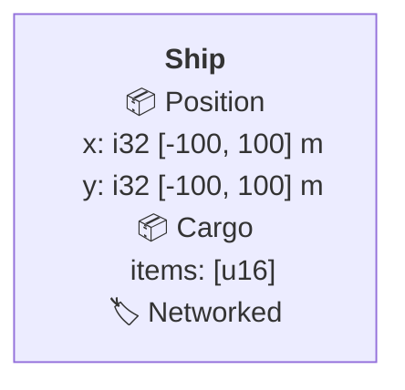
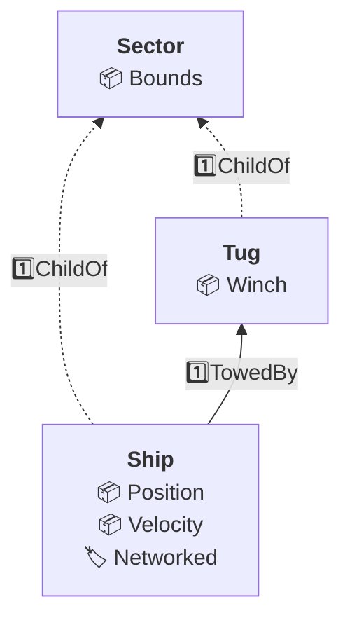
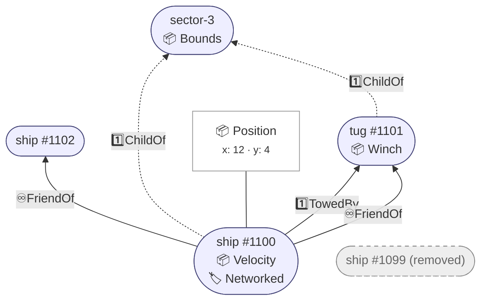
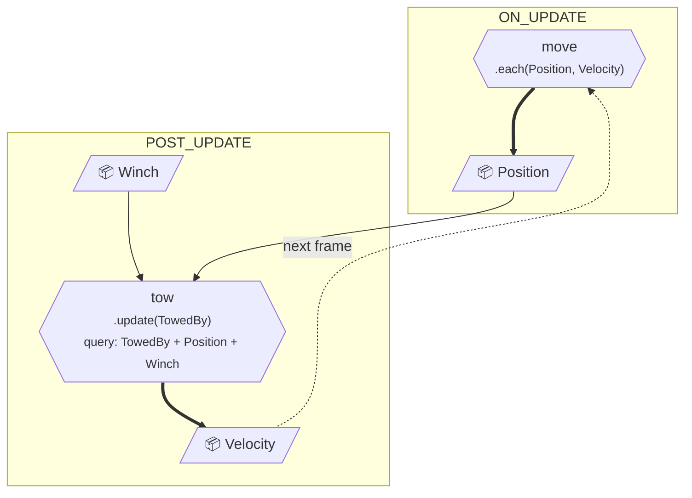

# ECS design diagrams

Draw entities, components, relationships, hierarchies, and systems consistently in docs, issues,
and PR discussions with these Mermaid flowcharts.

## Choose a diagram kind

| Kind      | Question it answers                                                       | Mermaid direction |
| --------- | ------------------------------------------------------------------------- | ----------------- |
| Schema    | Which kinds of entity carry what, and how do they relate?                 | `flowchart BT`    |
| Instances | What exists in a concrete scene or hierarchy, at frame N or before/after? | `flowchart BT`    |
| Systems   | What runs when, reading and writing what?                                 | `flowchart TB`    |

Use flowcharts for all three kinds, not `erDiagram`: ER attribute rows require both a type and
a name, whereas component lists need only one column. Keep diagrams small and give each one a
caption stating its scope. These are design views, not declarations of new vecs API types.

## Shared notation

Put the component-kind emoji immediately before its name in a single column. Use one line per
component, separated with ` ` inside a quoted label.

| Emoji | Kind                | Example          |
| ----- | ------------------- | ---------------- |
| 📦    | Component with data | `📦 Position`    |
| 🏷️    | Tag with no data    | `🏷️ Networked`   |
| 🎭    | Trait               | `🎭 Traversable` |

Draw a relationship as a labelled edge from the **carrier (source) to its target**. Always
write the arrow in that direction: `child --> parent`, never `parent <-- child`. Put the
target-count emoji first in the label, with no intervening space:

| Prefix | Targets allowed per carrier                                 | Example label            |
| ------ | ----------------------------------------------------------- | ------------------------ |
| 1️⃣     | At most one target (`Exclusive`); omit the word `Exclusive` | `1️⃣ChildOf`, `1️⃣TowedBy` |
| ♾️     | Many targets                                                | `♾️FriendOf`             |

The prefix describes the relationship's constraint, not the number of targets drawn. For many
targets, draw one edge per target, even though vecs stores the targets together in one relationship
component's array. See [Relationships](./relationships.md) for the runtime semantics.

Quote edge labels containing emoji. Only `ChildOf` uses a dotted relationship edge
(`child -. "1️⃣ChildOf" .-> parent`); every other relationship uses a solid edge
(`ship -- "1️⃣TowedBy" --> tug`). Do not use dotted edges for other parent-like relationships.

### Member types

When a design depends on what a component holds, list its members under the component in a
schema box, one indented line each. Use the [reflection member type](./reflection.md#member-types-libvecssrcreflectionmember_typests)
names and add a range or unit only when it matters to the design:

Leave members out where the component's name says enough. Tags have no members.

## Schema template

Use a box for each entity kind: a **bold** name, then one line per component. Relationships live
on edges rather than being repeated in the component list.

Use `flowchart BT` so parents sit above children. Let `ChildOf` determine the vertical hierarchy;
fit other relationships around it, including parent-like relationships such as `TowedBy`. Fall
back to `flowchart LR` only when `BT` becomes cluttered; keep carrier-to-target arrows unchanged.

This schema describes possible ship and tug entities inside a sector. `TowedBy` is an example
custom relationship configured as `Exclusive`, not a built-in.

## Instances template

Use a stadium `([…])` for a concrete entity: its name or `#eid`, then one line per component.
Keep the schema's `BT` layout rule and relationship notation. State the frame or before/after
moment in the caption so a snapshot is not mistaken for a schema.

When a component's data matters, move it out of the stadium into a small box attached by a
plain line (`---`). Put its fields in `<small>…</small>` text; do not also list that component
inside the stadium. Style destroyed or removed entities with `:::gone`: grey fill and a dashed
border. In a before/after comparison, explain whether retained edges show historical state.

At frame N, ship #1100 and tug #1101 belong to sector-3. The ship has two `FriendOf` targets;
the grey entity is a removed ship shown for comparison, with no live edges.

## Systems template

Use `flowchart TB` to follow execution down the page:

- Put each phase in a `subgraph` named after that phase, in pipeline order.
- Draw each system as a hexagon `{{…}}`: name, then kind and query in small text. Use
  `.each(…)`, `.run()`, or `.enter(…)` / `.update(…)` / `.exit(…)` as appropriate. Include cadence
  or disabled state in the label when relevant. These labels summarize callbacks and query
  membership; see [Systems](./systems.md) for API signatures.
  When the callback's arguments show the query, show it only once; add a separate `query:`
  line only when the callback and query differ.
- Draw components as parallelograms `[/…/]`, with **one node per component** across the entire
  diagram, even when several systems use it. Place each component node in the phase of its first
  writer in the diagram, or, if nothing in the diagram writes it, in the phase of its first reader.
- Draw a read as a thin arrow (`-->`) entering the system's top, and a write as a thick arrow
  (`==>`) leaving its bottom, where the layout allows.
- If a read only sees the previous frame's write, draw a dotted arrow labelled `next frame`
  looping back upward. This is a temporal data dependency, not a relationship edge. Do not
  hide the delay by duplicating the component node.

Here `move` reads last frame's `Velocity` and writes `Position` in `ON_UPDATE`. Later, `tow`
reads `Position` and `Winch` and writes `Velocity` in `POST_UPDATE`; `move` sees that write
next frame. The names describe an illustrative design, not built-in systems.
Component nodes sit inside phase boxes here to stabilize the layout; that placement does not
declare component ownership or lifetime.

## Check before sharing

Run `npm exec --no -- vmethod check-markdown <file>` on every Markdown file containing your
diagrams. This checks fences and parses Mermaid with the pinned GitHub-compatible version;
it does not inspect the rendered layout.

Also render every diagram, for example in GitHub's preview, and check that labels remain readable,
parents sit above children, phases follow pipeline order, and reads enter from above and writes
leave below where the layout allows. Layout is automatic: rearrange declarations or simplify a
crowded diagram rather than reversing a relationship arrow or duplicating a component.

For a worked schema and hierarchy, see [Relationships — diagram examples](./relationships.md#diagram-examples).
