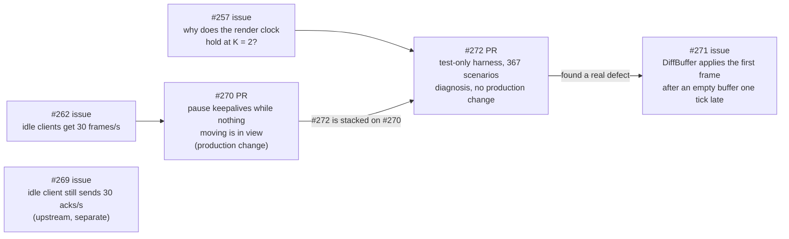

[orchestrator] Context for the set (#262 → #270, #257 → #272, then #271), as asked.

## The problem they address

With dead reckoning (`DeadReckonedModule`, `keepAliveFrames: 1`), the server sends every client a frame **every tick, 30/s, even when nothing moves**. The client needs those keepalives to advance its render clock (`renderFrame`). For an idle scene that is pure waste: about 30 packets/s per client, downstream, for nothing. That is #262.

```mermaid
sequenceDiagram
    participant S as Server (30 Hz)
    participant C as Client
    Note over S,C: Today (1.0.55): everything at rest
    loop every tick
        S->>C: keepalive frame (no content)
        C-->>S: ack
    end
    Note over S,C: With #270: nothing moving in this client's view
    S->>C: last content frame
    C-->>S: ack
    Note over S: gate closed, last content acked: send nothing
    Note over C: renderFrame holds; blends run on render-loop time
    Note over S,C: a body starts moving
    S->>C: new moving baseline (keepalives resume)
```

## What each PR does



| PR       | Changes                                                                                                                                                                                                                                   | Gain                                                                                                                                                                                                                                                                                                        | Cost / risk                                                                                                                                                                                                                                                        |
| -------- | ----------------------------------------------------------------------------------------------------------------------------------------------------------------------------------------------------------------------------------------- | ----------------------------------------------------------------------------------------------------------------------------------------------------------------------------------------------------------------------------------------------------------------------------------------------------------- | ------------------------------------------------------------------------------------------------------------------------------------------------------------------------------------------------------------------------------------------------------------------ |
| **#270** | **Server:** `ServerWorld.keepAliveWhile(dsl)`, a per-view gate. **Phaser server:** an internal `DeadReckonedMoving` tag drives that gate. **Phaser client:** correction and fade blends run on render-loop time instead of `renderFrame`. | An idle client goes from **30 frames/s to 0** downstream. No wire change. `idleKeepAlive: false` restores today's behaviour.                                                                                                                                                                                | `renderFrame` stops advancing while idle, so client effects must use render-loop time. The first moving frame after a pause can arrive one frame late and blend (#271). Measured: +2% with 200 moving bodies and 8 clients. Conflicts with `dev` since 2026-10-10. |
| **#272** | Tests only: a deterministic replication harness and a render-clock measurement matrix.                                                                                                                                                    | **Answers #257.** Render-clock holds come from the design's own limit, never rendering past the newest frame received, once there is loss or a server/client tick-rate mismatch (0.2 Hz of drift ≈ one held tick every 5 s). It also finds one real local bug, #271, with a failing test ready for the fix. | None in production. It is evidence for choosing how sparse keepalives (`K` > 1) could work.                                                                                                                                                                        |

## What I'd do

1. **Merge #270** after a `dev` merge. It is a real bandwidth win, and SpaceRocks' resting containers are exactly its case: a sector with nothing moving stops costing anything downstream.
2. **Merge #272** as test infrastructure: no production risk, and the next fix needs it.
3. **Fix #271** on top, using #272's harness for before/after evidence.
4. **Decide later** whether sparse keepalives (`K` > 1) are worth a clock redesign. #272's findings list the options; nothing needs deciding now.
5. #269 (idle upstream acks) is separate and small.

If you agree, say "take over" and I'll get #270 and #272 updated to current `dev` and reviewed again before they come back to you.
